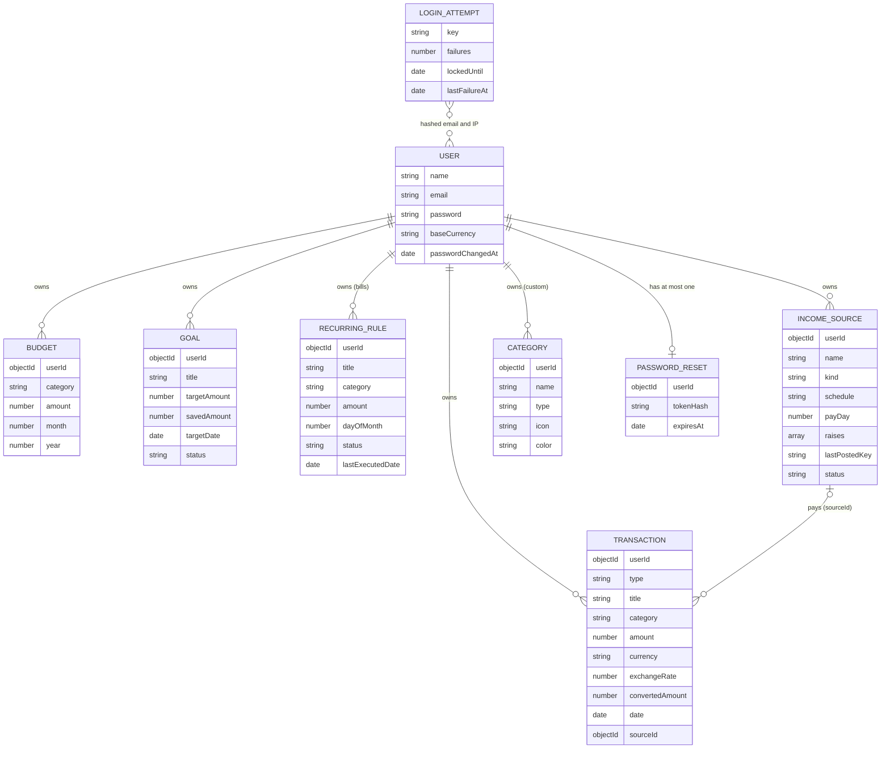

# SpendWise — MERN personal finance tracker

A full-stack expense tracker built with React + Vite, Node.js, Express, MongoDB Atlas and Mongoose. Includes JWT authentication, income/expense CRUD with server-side pagination, monthly category budgets, savings goals, scheduled transactions, analytics charts and multi-currency records.

## Requirements

- Node.js 22 LTS (or another version supported by current Vite)
- npm
- MongoDB Atlas free cluster (or local MongoDB)

## Run locally

1. Open a terminal in the project root (`spendwise`).
2. Install dependencies:

   ```bash
   npm install
   npm run install:all
   ```

3. Create `server/.env` by copying `server/.env.example`. Add your MongoDB Atlas connection string and a long random JWT secret.
4. In `client`, copy `.env.example` to `.env` (the default API URL works for local development).
5. Start both applications from the project root:

   ```bash
   npm run dev
   ```

6. Open http://localhost:5173. The API health endpoint is http://localhost:5000/api/health.

If you prefer separate terminals, run `npm run dev` inside `server` and `npm run dev` inside `client`.

## Demo account and sample data

For a demo, a video or a first look, fill an account with realistic data (about 300 transactions over three and a half months, a salary with a pay rise, two side-income sources, custom categories, budgets, goals and bills):

```bash
npm run seed
```

Then sign in with **`demo@spendwise.app`** and password **`Demo@2026`**. Running the command again resets that account to a fresh copy, and it never touches any other account. It refuses to run when `NODE_ENV=production`. The data is built relative to today's date, so the demo always looks current.

## Password reset by email (optional)

Forgot-password works without any setup: the reset link is printed in the server console. To send real emails, fill in the `SMTP_*` settings in `server/.env` (for Gmail: turn on 2-step verification, create an "App password", and use it as `SMTP_PASS`). For a demo with no email server you can also set `RESET_LINK_IN_RESPONSE=true`, which shows the link on screen. That setting is ignored when `NODE_ENV=production`.

## API collection (Postman)

Import `docs/SpendWise.postman_collection.json` and `docs/SpendWise.postman_environment.json` into Postman. Run **Auth > Login** first (its script saves the token), then try any folder. Create requests save the new id, so Update and Delete work straight away. There is one request for every endpoint (55 in total).

## MongoDB Atlas setup

1. Create a free M0 cluster in MongoDB Atlas.
2. Create a database user and password.
3. Add your current IP address to Network Access while developing. For a serverless deployment, configure Atlas network access according to Atlas' current guidance; do not expose database credentials in frontend variables.
4. Copy the Node.js connection string and replace the username, password and cluster placeholder.
5. Put it in `server/.env` as `MONGO_URI=...`.
6. Use a long random value for `JWT_SECRET`.

Never commit `.env` files. They are excluded by `.gitignore`.

## Deploy to Vercel

Deploy the backend and frontend as two Vercel projects from the same GitHub repository:

### Backend project

- Import the repository into Vercel.
- Set Root Directory to `server`.
- Vercel will use `server/vercel.json` and the Node.js function entry point.
- Add environment variables:
  - `MONGO_URI` = your Atlas connection string
  - `JWT_SECRET` = a long random secret
  - `CLIENT_URL` = your deployed frontend origin (for example `https://your-spendwise.vercel.app`)
- Deploy and check `/api/health` on the backend domain.

### Frontend project

- Import the same repository as another Vercel project.
- Set Root Directory to `client`.
- Framework preset: Vite.
- Add environment variable `VITE_API_URL` = your backend domain plus `/api` (for example `https://your-spendwise-api.vercel.app/api`).
- Deploy.

After deployment, update the backend `CLIENT_URL` to the exact frontend origin and redeploy the backend if needed. Vite environment variables are embedded at build time, so redeploy the frontend after changing `VITE_API_URL`.

## Multi-currency behaviour

Each transaction stores its original amount and currency, plus an exchange rate and converted amount for the account's base currency. Enter `1` when the transaction currency matches your base currency. For another currency, enter the rate you want to use (for example, if 1 USD = 83 INR, enter 83 for a USD transaction when INR is your base currency).

This starter intentionally asks for the exchange rate rather than silently using a potentially stale quote. Converted historical values are snapshots. Choose the account's base currency before recording transactions; changing it later does not automatically recalculate historical conversion snapshots.

## Project structure

```
server/
  config/        db connection + startup environment checks
  controllers/   business logic (auth, transactions, budgets, goals, recurring, analytics)
  middleware/    auth, Joi validation, rate limiting, central error handler
  models/        Mongoose schemas
  routes/        thin route files that wire middleware to controllers
  validators/    Joi schemas for every request body and query string
client/src/
  api/           axios instance with token + session-expiry handling
  components/    layout/, ui/, and feature components (modals, tables)
  context/       Auth, Preferences, Finance data, Toast and Confirm providers
  hooks/         useFinanceActions, useFormat, useCountUp, useDebounce, useAlerts
  pages/         one file per route (Overview, Transactions, Budgets, Goals, Scheduled, ...)
  styles/        design tokens and component styles (light and dark themes)
```

The client uses React Router (`/`, `/transactions`, `/budgets`, `/goals`, `/scheduled`, `/analytics`, `/profile`, `/settings`). `client/vercel.json` rewrites every path to `index.html` so deep links work after deployment.

## Security and reliability

- **Validation:** every body and query string is validated with Joi. Unknown fields are stripped, and malformed ObjectIds return `400` instead of hanging the request.
- **Error handling:** all handlers are wrapped so rejected promises reach one central error middleware that returns consistent JSON (`CastError`, Mongoose validation, duplicate keys, expired tokens and bad JSON are all mapped to proper status codes).
- **Hardening:** `helmet` security headers, `express-rate-limit` (1,500 requests per 15 minutes overall, 10 failed register or password-change attempts per 15 minutes, and a 50-failure backstop per network on sign-in), bcrypt with cost 12, 7-day JWTs, a login timing guard, and per-user ownership checks on every query.
- **Startup checks:** the server refuses to start if `MONGO_URI` or `JWT_SECRET` is missing or weak (under 16 characters, or the example value in production). On Vercel the same problem is reported as a clear `500` message on every API call.
- **Rate limit note:** the limiter keeps counts in memory. On serverless platforms each instance counts separately, so use a shared store (for example Redis) if you need exact global limits.
- **Progressive sign-in lockout:** the first four wrong passwords carry no wait. After that the wait grows with every failure: 30 seconds, 1 minute, 5 minutes, 15 minutes, then 1 hour each time. Attempts are counted per email and network address together, so a stranger typing wrong passwords cannot lock the real owner out from another network. Counts are stored in MongoDB (`LoginAttempt`, keyed by a SHA-256 hash so no email or IP is kept in readable form) and deleted automatically 24 hours after the last failure. The sign-in page shows a live countdown, and a correct sign-in resets everything. Unknown emails escalate exactly like real ones, so the lockout reveals nothing about which emails are registered.
- **Sessions are checked against the account:** every protected request confirms the account still exists and that the token is newer than the last password change. Deleting an account or changing or resetting a password therefore signs out every other device straight away, instead of leaving old tokens valid until they expire.
- **Forgot password:** a random 256-bit token is emailed (or printed in the console), only its SHA-256 hash is stored, it expires after 30 minutes, it works exactly once (consumed atomically), and asking again replaces the old link. The reply is identical whether or not the email has an account, and requests are capped at 5 per hour per network. A small timing difference can still exist between known and unknown emails because only known ones send mail.
- **Delete account:** requires the password, removes the user and everything they own across all collections (the user record last, so a failure part-way can be retried), and ends the session.
- **Passwords:** 8 to 72 characters with at least one letter and one number, enforced on the server and previewed with a strength meter on the sign-up and change-password forms.
- **Dates are UTC-consistent:** transactions are stored as calendar days at UTC midnight, and every month, day and projection boundary is computed in UTC (`server/utils/dates.js`). Results are therefore identical on any server time zone. "This month" changes at 00:00 UTC. Dates are limited to 2000 to 2100 and amounts to two decimal places.
- **Atomic updates:** goal deposits use `$inc`, so two deposits made at the same moment can never overwrite each other.
- **Honest numbers:** nothing is projected or judged from part of a month. Reports compare a month with the one before only once it is finished, the health score uses completed months, and exports say when the 5,000-row cap cut the result off.
- **Automatic recording is safe to repeat:** bills and income sources are each claimed atomically before they post, so concurrent requests can never record the same month twice, a failed write puts the claim back so the next request retries, and day-31 pay days or bills land on the last day of shorter months.

## Database design

Nine MongoDB collections (Mongoose schemas in `server/models/`). Almost everything belongs to a user through `userId`, and every query filters on it, so one person can never read or change another person's data.



Design choices worth knowing:

- **Money is stored twice:** the amount as entered (`amount`, `currency`) and the value in the user's base currency (`convertedAmount`), so totals and charts never need to convert again.
- **Categories are plain text on records**, not references. Built-in categories live in code; custom ones live in the `Category` collection. Renaming or deleting a custom category updates the records that used it.
- **Income sources keep an amount history** (`raises`), and the amount used for a pay day is the latest entry that starts on or before it, so a raise never rewrites past months.
- **Indexes:** `(userId, date)` for lists and reports, `(userId, type, date)` for filtered totals, `(userId, title)` for autofill, a unique `(userId, category, month, year)` on budgets, a unique `(userId, nameKey)` on categories, and TTL indexes that make MongoDB delete expired reset tokens and old login attempts by itself.
- **Nothing sensitive is stored in readable form:** passwords are bcrypt hashes, reset tokens are stored as SHA-256 hashes, and lockout keys are hashes of email and IP.

## Pagination

`GET /api/transactions` is paginated and filtered on the server:

`?page=1&limit=10&type=expense&category=Transport&search=uber&month=11&year=2026&date=2026-11-20&sort=newest`

`limit` is capped at 100. The response contains `transactions`, `totals` (income and expenses for the whole filtered set) and `pagination` (`page`, `limit`, `total`, `totalPages`, `hasNext`, `hasPrev`). `GET /api/transactions/export` returns the filtered set without paging (up to 5,000 rows) for CSV export and backups.

## Standout features

- **Income sources:** enter your salary once (amount and pay day) and it is recorded every month. Add other sources too, either monthly or irregular (a side business, freelance work, investments). Setting up after this month's pay day asks whether the money has already arrived. A pay rise applies from a date you choose and never rewrites months already recorded. The Income page shows expected versus received this month, the side-income share, and a stacked chart of where income comes from. Old scheduled "money in" rules can be moved over with one click.
- **Custom categories:** create your own spending or income categories with an icon and colour, straight from any form ("New category...") or from Settings. Renaming updates every transaction, budget, bill and income source that used the name. Deleting one in use asks where its entries should move to. Quick add and CSV import recognise your category names too.
- **Reports (one page for Insights and Analytics):** pick any month and see income, spending, savings and savings rate; the last 3, 6 or 12 months in and out; where income came from and where spending went (with category-by-category comparison once the month is finished); and the health score.
- **Financial health score (0 to 100):** three transparent parts (savings rate 45, budget discipline 30, goal progress 25), each with a plain-language hint. It is scored on up to your last three completed months, so a few unlogged days cannot distort it, and it ignores how often you log. See `server/utils/insights.js`.
- **Catch-up reminder:** after a few quiet days the Overview offers a gentle nudge to add or import what you missed, and says nothing about how the numbers look.
- **Spending calendar on the Overview:** days are shaded by spending. Click any day to see that day's money in and out, its transactions and anything scheduled for it, or use **Add for this day** to log something you forgot (the form opens on that date).
- **Natural-language quick add:** type `coffee 180 yesterday` or `salary 50k` in the command palette (`Ctrl/Cmd + K`) or the add form. Amount, date, type and category are worked out for you (`client/src/utils/quickAdd.js`).
- **Autofill from history:** start typing a title and earlier entries appear, with category, amount and currency ready to reuse.
- **CSV import:** drop in a bank statement. Columns are detected automatically (including separate debit and credit columns), dates in several formats are understood, categories are guessed, and rows you already have are skipped. A preview shows what will be imported.
- **Bulk actions with Undo:** select many transactions to recategorise or delete them. Single and bulk deletes happen instantly and can be undone from the toast.
- **Duplicate guard:** adding the same type, title and amount within a day of an existing entry asks for confirmation first.
- **Suggested budgets:** one-click budgets based on your average spending over the last three months.
- **Keyboard shortcuts:** `N` adds a transaction, `/` opens search, `Esc` closes dialogs.

## Main API routes

- `GET/POST /api/categories`, `PUT/DELETE /api/categories/:id` (delete takes `?reassignTo=`), `GET /api/categories/:id/usage`
- `GET/POST /api/income`, `PUT/DELETE /api/income/:id`, `PATCH /api/income/:id/raise`, `POST /api/income/from-rule/:ruleId`, `GET /api/income/summary?months=`
- `POST /api/auth/register`, `POST /api/auth/login`, `GET /api/auth/me`, `PATCH /api/auth/preferences`, `PATCH /api/auth/profile`, `PATCH /api/auth/change-password`, `POST /api/auth/forgot-password`, `POST /api/auth/reset-password`, `DELETE /api/auth/account`
- `GET/POST /api/transactions`, `PUT/DELETE /api/transactions/:id`, `GET /api/transactions/export`, `GET /api/transactions/categories`, `GET /api/transactions/suggestions?q=`, `POST /api/transactions/bulk`, `POST /api/transactions/bulk-delete`, `PATCH /api/transactions/bulk-category`
- `GET/POST /api/budgets` (`?month=&year=`), `DELETE /api/budgets/:id`, `GET /api/budgets/suggestions`, `POST /api/budgets/bulk`
- `GET/POST /api/goals`, `PUT/DELETE /api/goals/:id`, `PATCH /api/goals/:id/deposit`
- `GET/POST /api/recurring`, `PUT/DELETE /api/recurring/:id`, `PATCH /api/recurring/:id/toggle`
- `GET /api/analytics/summary`, `GET /api/analytics/monthly`, `GET /api/analytics/trend?months=3|6|12`, `GET /api/analytics/daily?month=&year=`, `GET /api/analytics/report?month=&year=`, `GET /api/analytics/health`

All routes except register, login, forgot and reset password, and the health check require `Authorization: Bearer <token>`.

## Reliability on the client

- **Targeted refreshes:** a change refetches only the data it can affect (a transaction updates the summary, chart, budgets and insights; a goal deposit updates goals and insights) instead of reloading everything. Scheduled transactions are read first, so anything they record is included in the numbers that follow.
- **Session handling:** an expired session signs you out with a clear message; a wrong password on the change-password form does not.
- **Accessibility:** dialogs trap keyboard focus, restore focus when closed and are labelled for screen readers.
- **Resilience:** an error boundary shows a friendly page instead of a blank screen, and pages are lazy-loaded so the first load is small.
- **Imports that don't silently go wrong:** European number formats (1.234,56), day-first or month-first dates, debit and credit columns and `Dr` or `Cr` suffixes are all understood.
- **Indian number grouping** for INR (12,34,567.89).
- A getting-started checklist guides new accounts through their first transaction, salary, budget and goal.

## Interface highlights

- Light and dark themes (follows your system on first visit) with a custom logo and favicon.
- `Ctrl/Cmd + K` command palette to jump to any page, quick-add a transaction or search your history.
- Notification bell that surfaces budgets over 80%, overdue goals and bills due within three days.
- Animated balance, 3 / 6 / 12 month chart ranges, an interactive spending donut, month-by-month budget navigation, and goal progress rings.

## Notes before production

This project is intended for learning and portfolio use. Before handling real financial data, consider adding automated tests, role-based access control, a refresh-token strategy, audit logging and a privacy policy. Never use real banking credentials or card details in this application.
